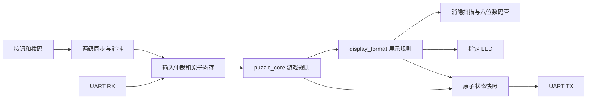

# 设计说明与课程要求对应

## 依据

课程 Blackboard：数字逻辑（2026秋）→ labs & Project，2026-11-17 下载的项目要求、EGO1 用户手册 v2.2 和配套 XDC。目标 FPGA：`xc7a35tcsg324-1`，100 MHz 时钟 P17；手册确认数码管的位选、段选与 LED 都高有效，UART 的 FPGA 接收端 N5 / 发送端 T4。

原始文件只保留在本地 `reference/`，Git 仓库只存自主实现、测试和说明。课程后续可能发布 Classroom / GitLab 专用仓库和视频规范，需发布后另行对接。

## 模块与数据流

只有 P17 的 100 MHz 一个时钟域，消抖、闪烁、扫描、UART 都使用计数器 / 时钟使能，不用逻辑分频信号做时钟。

- `input_filter.v`：输入两级同步标记 ASYNC_REG，逐位稳定检测，按钮 10 ms / 拨码 1 ms。按键按下脉冲只有一个周期，必须稳定释放后才能再次触发。
- `puzzle_top.v`：外部复位异步断言、三级同步释放，寄存器有定义的上电复位；输入仲裁后整体寄存一拍，分开 UART ASCII 解码与移动判定路径。相同周期按实体 S0 时优先选拨码数据。
- `puzzle_core.v`：INIT / PLAY / WON 三态，棋盘 9×4 bit、已用数字位图、初始化位置、有/无效计数、一次撤回快照。组合的九格邻接表同时服务移动判定和提示，避免行尾与下一行开头误判相邻。
- `display_format.v`：0 与未输入均为空白，输入错误显示 E；第九格与所有 LED 按物理意义映射；通关十进制读数和 LED 完整计数来自同一寄存器。
- `seven_segment.v`：两个四位组并行扫同一列，每 250 us 切列，整屏刷新 1 kHz。切列先关闭位选，再更新段码，最后点亮，避免前后位重影。
- `uart.v`：115200 / 8N1，整数分频 868，误差约 0.0064%；接收中点采样，校验起始位和停止位。

棋盘 cell0 存在 `board[3:0]`，cell8 存在 `[35:32]`。未输入为 F，0 保留真实空格意义。数码管显示字段独立用 F 表示空白、E 表示输入错误，避免将棋盘 0 误显示为字符 0。

## 需求追踪

| 课程功能 | 对应行为 | 验证 |
|---|---|---|
| 复位、初始化（10） | 任意阶段 S6 清空；逐格 0–8，拒绝重复及越界；原位 E / 第九格全亮 | 模型向量所有输入位置；顶层物理输入测试；实板错误初始化 |
| 移动、判定、计数（二进制）（25） | 按编号选棋子，仅上下左右可移动；无效不改盘；两计数独立 | 九种空格位置 × 16 种输入；行边界、零号、饱和与随机棋局 |
| 提示（10） | 1–8 对应固定八灯；棋盘改变后组合更新 | 模型预测提示及实板 LED 输出快照 |
| 通关、十进制统计（10） | 第九次输入即可识别已通关；移动后检测目标；S0 显示两位十进制 | 直接目标盘 / 移动通关；17 / 18 完成棋局统计 |
| 撤回（5） | 最近一次有效或无效移动，包括通关步，恢复盘/计数/错误状态 | 有效、无效、赢棋、重复撤回与随机输入 |
| 演示（10） | 五幕可循环；S1 可展示提示/统计；复位幕全灭 | 顶层实体按钮路径及实板串口控制 |
| 视频文档（10） | 本仓库设计、操作、验收记录及分镜 | 实拍视频仍需按课程后续规范录制 |

## 边界决策

1. **合法布局仅检查 0–8 唯一性**。原文未要求逆序数 / 可解性检测，因此允许不可解排列；不会擅自改变初始化评分标准。
2. **统计位宽**。题目四灯二进制与至少两位十进制存在容量差异。本设计保存 0–99，两页展示完整二进制，默认页为低四位；大于 99 饱和，避免悄悄回绕成 0。此扩展在计数 0–15 范围与原文完全一致；答辩时先说明分页约定，并以教师后续解释为准。
3. **撤回范围**。只有最近一次游戏确认操作生成快照，无论其有效与否；撤回不生成新历史。初始化、视图切换不会污染移动快照，复位 / 模式切换清除历史。
4. **通关后操作**。S0 在棋盘与统计之间切换；计数和棋盘保持；S2 仍可撤回赢棋操作。
5. **演示状态**。进入演示后 S3 加载第一幕，遵循“一次按键展示一幕”；第五幕全暗，内部保持可重播状态。S4 可回到手工棋局。
6. **并发优先级**。全局复位 > 串口复位 > 模式切换 > 演示推进或撤回 > 确认；展示切换可与普通操作并行，复位 / 模式切换会重置展示页。
7. **原文笔误**。3.6 第三幕开头“无效步数统计+1”与该幕数值矛盾，应为有效步数 +1；目标盘提示中列出“(6,8)”是正确结果，位图 `0000_0101` 也正确。

## UART 协议

命令都是单字节 ASCII。`a` 启用高级控制，`z` 禁用；`?` 在任何模式只读，其余写操作须已启用。数字 0–9 与大写 A–F 会执行确认，支持主动测试越界。小写 `c/r/u/v/d/n/h` 分别对应确认、复位、撤回、展示、模式、演示推进、统计高低页。

收到 `?` 时，将一组寄存器及逻辑输出**同时锁存**，再逐字节发送 28 字节；没有自动推送，因此不会混淆命令回应。忙时新的查询会忽略，主机串行等待；主机默认 1 s 超时，校验并从噪声中重同步。

| 字节 | 内容 |
|---|---|
| 0–1 | A5 5A 帧头 |
| 2 | 协议版本 1 |
| 3 | bit0 演示、1 错误、2 通关统计、3 提示视图、4 可撤回、5 UART 控制、6 高四位页 |
| 4–5 | 状态 0/1/2，已输入格数 |
| 6–7 | 有效 / 无效计数，各 0–99 |
| 8–9 | 提示位图，演示幕号 |
| 10–18 | 九格真实值，未输入为 0F |
| 19–22 | 八位显示字段，小端；每个半字节对应一位，0F 空白、0E 错误 |
| 23–24 | 实际 LED 逻辑值的低 / 高字节 |
| 25–26 | 保留为 0 |
| 27 | 对字节 2–26 的 XOR |

主机 CLI 不计算或替代游戏规则。只有验收脚本的独立模型预测结果用于与实板返回值比对，真正的移动、计数、提示与演示都在 FPGA 中执行。

## 物理实现和约束

XDC 将所有 54 个端口位约束到已核对的管脚，LVCMOS33；设置 100 MHz 周期和配置电压 3.3 V。异步输入仅 pad→第一级同步器路径设例外，第二级以后照常检查时序；LED / 数码管 / 异步 UART 输出没有外部同步时钟，因此设为异步输出路径例外。没有放宽整个游戏逻辑的时序约束。

`make build` 会输出综合/实现利用率、布线后 setup/hold、DRC、CDC、约束检查、methodology 报告；只有通过 setup、hold 和 DRC Error 检查才允许生成 bitstream。`make program` 检查只有一个目标且器件为 xc7a35t，下载后核对 DONE=1 / CRC_ERROR=0；只配置易失 FPGA，不写持久 Flash。
