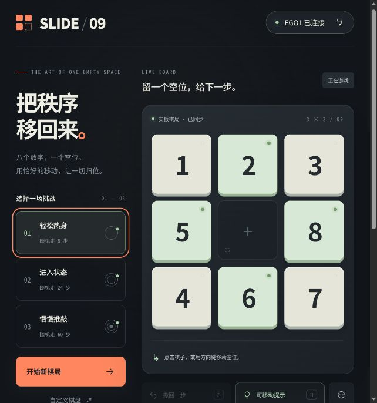

# SLIDE / 09 图形界面与电脑键盘

这个版本使用电脑键盘和鼠标控制真实 EGO1。浏览器通过本机 Python 串口桥接读取 FPGA 棋盘；规则、计数、撤回与通关仍由 FPGA 执行。现有 v1.0 bitstream 可以直接使用，无需重新烧录。



## 启动

```bash
cd /home/tfx/projects/cs207-project-2026
make gui
```

打开 <http://127.0.0.1:8765>，点击右上角「连接开发板」，选择 B 通道并连接。连接不重置当前棋局；可继续原局，或点击「开始新棋局」。只需 Python 3.10+ 和现代浏览器，无 npm / pip 依赖。

如端口被占用，可用 `python tools/gui_server.py --port 8766`，再访问对应地址。GUI 服务只监听 127.0.0.1，不对局域网开放。

## 玩一局

1. 选择轻松热身、进入状态或慢慢推敲，点击「开始新棋局」。这三档从目标盘随机走 8 / 24 / 60 步生成，保证可解；这些数字不是保证的最短解长度。
2. 点击棋子，或按方向键移动空位。浅绿色数字及圆点表示当前可以移动的棋子；提示与板上八灯同步。
3. 排成 `123456780` 时通关。GUI 显示庆祝效果，板上通关灯长亮；Enter 可切换板上数码管统计。
4. 「自定义棋盘」可输入九位布局，例如 `123456708`。0 是空格，0–8 各出现一次。不可解的排列会提示，但仍允许写入，以保持课程规定的初始化语义。
5. 「清空棋盘」返回逐格输入；可直接用数字键输入九格，也能点击屏幕数字键盘。

## 快捷键

操作时让浏览器页面处于前台。输入框或弹窗聚焦时，快捷键不会干扰文字输入。

| 按键 | 功能 |
|---|---|
| ↑ ↓ ← → | 朝该方向移动**空位**，相邻棋子反向进入原空位 |
| 1–8 | 按棋子编号执行移动；初始化时直接输入并确认 |
| 0 / 9 | 也会发送给 FPGA，可用于初始化 0 或测试非法输入 |
| Z | 撤回最近一次移动，包括非法移动和赢棋操作 |
| H | 切换提示 / 统计，与板上 S1 对应 |
| R | 按当前难度开始新局，清空原棋局与步数 |
| D | 进入 / 退出演示；进入时自动展示第一幕 |
| 空格 | 演示下一幕 |
| Enter | 通关后切换板上数码管的棋盘 / 十进制统计 |

长按自动重复的键盘事件被忽略，每次实际按下执行一次。操作进行中会暂时禁用输入，避免同一次点击重复发送。方向键会读取实板最新空位位置再选棋子，而不是依靠浏览器可能过期的棋盘。

## 界面说明

- 左侧是难度和自定义开局，中间是动画棋盘，右侧/窄屏下方显示完整计数、会话计时、可移动数字和板载八灯。
- 有效 / 无效步数来自 FPGA 的 0–99 计数器；「本次计时」由浏览器记录本次会话，不代表板上保存的游戏时长，刷新页面后重计。
- 右侧 LOW / HIGH 对应板上计数低 / 高四位页，提示视图下八灯仍显示提示。
- 断线后保留最近棋盘作为离线画面，禁用写操作，并明确提示离线；不会切换成软件模拟游戏。
- 点击右上角已连接状态可断开，关闭串口写控制并释放设备。只关闭浏览器标签不会停止后台桥接；终端 Ctrl+C 可退出服务并释放串口。
- GUI 占用串口期间，请不要同时运行 `make verify` 或另一个串口助手；GUI 自身验收使用 `make verify-gui`，经同一桥接链路访问。
- 板上 S6 仍可复位。GUI 的只读轮询不重新启用写控制；下一次用户明确操作 GUI 时才恢复串口控制。

## 验证

```bash
make check-gui       # Python 桥接/API/串口协议测试 + JS 语法检查
make verify-gui      # 已启动 GUI 服务且接上板卡时，执行真实 FPGA 验收
```

桥接对外只有固定命令、合法布局和方向操作，串口只允许已发现的 B 通道。单个串口会话用锁串行处理，浏览器用递增修订号丢弃过期响应。HTTP 写请求校验本机会话标记、Host 和 Origin；状态查询不会改变棋局。

本版包含 14 项软件测试及 114 次 GUI→HTTP→UART→真实 FPGA 的独立模型对照，详见 `reports/gui_tests.txt` 与 `reports/gui_hardware_acceptance.json`。浏览器实测包含数字键非法移动、方向键通关、Enter 统计、Z 撤回、H 提示、D 演示、空格推进以及鼠标初始化。
